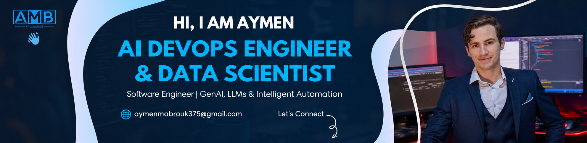

<div align="center">
  
</div>

<br><br>

<h1 align="center">
  
  Welcome! I'm <a href="https://www.aymenmabrouk.dev/">Aymen Mabrouk</a>
  
</h1>

<br>

<p align="center">
  
</p>

<div align="center">
  
</div>

## 🚀 About Me


<br>

🎓 **Engineering Degree in Data Science** (EUR-ACE Accredited) — Polytechnique Sousse  
🎓 **Master's Degree in Software Engineering** — ISIM Monastir (ISIMM)  
🤖 **AI & Automation Engineer** specializing in **Agentic Tools**, **MCP Agent/Sub-Agent Architectures** & **GPU Workloads**  
☁️ **Microsoft Certified Associate** (`AI-103`, `AZ-104`, `DP-800`) & **Oracle Cloud Professional**  
🔬 **5+ Years Building Software & AI Solutions** with published deep-learning research  
🎯 **Specialist in Prompt Engineering, Context Engineering & Production RAG Systems**

### 💡 What I Build & Focus On

**🧠 Agentic Tools & MCP Architectures**  
Designing multi-agent and sub-agent orchestration systems, Model Context Protocol (MCP) tool servers, and autonomous workflows with LangGraph, CrewAI, and AutoGen

**🔄 N8N & Intelligent Workflow Automation**  
Building resilient enterprise automation pipelines, multimodal document/OCR extraction, and LLM-powered integrations

**⚡ GPU Workloads & Production MLOps**  
Deploying and scaling containerized GPU inference pipelines, distributed task queues (Celery/Redis), and automated ML lifecycle workflows

**🌊 Enterprise RAG & Context Engineering**  
Architecting hybrid retrieval systems with vector databases (Qdrant, Pinecone, Chroma), structured tool calling, and multilingual voice/STT assistants

**📊 Data Science & Computer Vision**  
Delivering end-to-end predictive analytics, deep learning, YOLOv8, and OpenVINO pipelines from research to production

**🌐 Full-Stack AI Applications**  
Shipping responsive web and mobile AI products using React, Next.js, Angular, Flutter, and FastAPI

<br clear="right"/>

<!-- Snake Animation -->
<div align="center">
  
</div>

## 🏆 Certifications & Credentials

| Certification | Issuer | Core Focus |
| --- | --- | --- |
| **Azure AI Apps and Agents Developer Associate (`AI-103`)** | Microsoft | Generative AI, Agentic Workflows & Azure AI Solutions |
| **Azure Administrator Associate (`AZ-104`)** | Microsoft | Cloud Infrastructure, Compute, Networking & Governance |
| **SQL AI Developer Associate (`DP-800`)** | Microsoft | Data Engineering, Vector Search & AI-Enabled Databases |
| **OCI Generative AI & Data Science Professional** | Oracle | Multiple Oracle Cloud Infrastructure Professional AI/ML Credentials |

## 🛠️ Tech Arsenal

### 🧠 Agentic AI, LLMs & GenAI

<div align="center">
  
  
  
  
  
  
  
  
  
  
  
  
</div>

### 🔄 Automation, Vector DBs & MLOps

<div align="center">
  
  
  
  
  
  
  
  
</div>

### 💻 Frontend & Mobile

<div align="center">
  
</div>

### ⚙️ Backend & Database

<div align="center">
  
</div>

### ☁️ Cloud, GPU Workloads & DevOps

<div align="center">
  
  <br><br>
  
  
</div>

### 🛠️ Development & Productivity Tools

<div align="center">
  
  
  
  
</div>

## 🎯 Featured Projects

<div align="center">

### 🚀 Explore My Work

<a href="https://www.aymenmabrouk.dev/">
  
</a>

</div>

<br>

| Project | Description | Tech Stack |
| --- | --- | --- |
| 🤖 **[MCP-SDK & Agentic Workflows](https://github.com/AymenMB/MCP-SDK)** | Agent/sub-agent orchestration, MCP tool servers, automated pipelines & GPU-backed execution | MCP, TypeScript, Python, LangGraph, N8N, Docker |
| ⚖️ **TuniJuris-AI** | Multi-domain Hybrid RAG assistant with 15-domain routing, 94.2% retrieval precision & trilingual voice AI | LangGraph, LangChain, Gemini, React, TypeScript, Supabase |
| 🛩️ **AeroGuard (RUL Prognostics)** | End-to-end MLOps pipeline for aerospace turbofan predictive maintenance (63% RMSE reduction) | Python, R, XGBoost, ZenML, MLflow, Optuna, DVC, Azure |
| 🛒 **SouqAI** | AI-native e-commerce platform with multimodal generation & personalized discovery | Google Gemini, Veo 3.1, React, TypeScript, Vite, Supabase |
| 🎾 **Sports Analytics Platform** | Deep-learning tennis & padel match analytics (ball tracking, bounce detection, 2D mapping) | Python, OpenCV, TensorFlow, YOLOv8, CatBoost |
| 🚗 **[Smart Parking & ANPR Microservices](https://github.com/AymenMB/Vehicle-Entry-Exit-Registration-System---Microservices-)** | IoT parking & vehicle entry/exit recognition system achieving 98.5% OCR accuracy | OpenVINO, FastAPI, Flutter, Next.js, PostgreSQL, Redis |

## 🧭 Education & Engineering Journey

```text
🤖 2025–Present │ Independent AI & Automation Engineering
                │ • Agentic tools & MCP agent / sub-agent architectures
                │ • GPU-accelerated inference workloads & distributed pipelines
                │ • Enterprise N8N workflows, Hybrid RAG & multimodal systems
                │
🎓 2023–2026    │ Engineering Degree in Data Science @ Polytechnique Sousse
                │ • EUR-ACE Accredited | Deep Learning, Computer Vision & MLOps
                │
🎓 2023–2025    │ Master's Degree in Software Engineering @ ISIMM
                │ • Distributed Systems, Microservices & Full-Stack Architecture
                │
🎓 2020–2023    │ B.S. in Computer Science @ ESST Hammam Sousse
                │ • Algorithms, Software Architecture, Databases & IoT Systems
```

## 🌟 Achievements & Recognition

🤖 **Agentic & Automation Specialist**: Architected production MCP agent/sub-agent systems and high-volume N8N workflows  
⚡ **GPU & Cloud Infrastructure**: Built and scaled GPU-backed AI inference and MLOps workloads across cloud environments  
☁️ **Multi-Cloud Certified**: Microsoft Certified Associate (`AI-103`, `AZ-104`, `DP-800`) & multiple Oracle Cloud (`OCI`) Professional certifications  
📄 **Published Researcher**: Deep-learning sports analytics research recognized for automated match & trajectory analysis  
🎯 **98.5% Recognition Accuracy**: Achieved high-precision vehicle & license plate recognition using OpenVINO and computer vision  
🌟 **Open Source Contributor**: Active builder across MCP tooling, ML pipelines, and full-stack AI repositories  

## 🌐 Let's Connect

<div align="center">

[](https://www.aymenmabrouk.dev/)
[](https://www.linkedin.com/in/aymen-mabrouk-91102b23b/)
[](https://github.com/AymenMB)
[](mailto:aymenmabrouk375@gmail.com)

</div>

---

<div align="center">
  
</div>

<div align="center">
  <sub>🚀 Always open to collaborating on innovative AI & automation projects! Let's build something impactful together.</sub>
</div>
